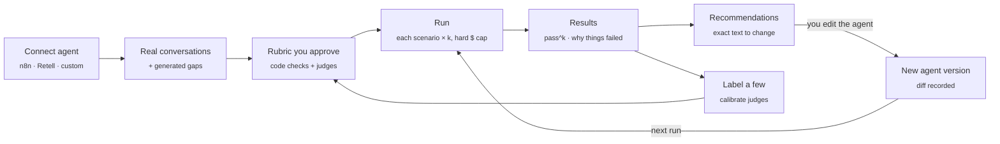

<div align="center">


# **Hone**

### **Test your AI agent on real conversations, with judges you can trust.**

Hone connects to the agent you already run, replays the conversations your customers really have,
grades every reply against a rubric you approve, and tells you what to change, then checks whether
the change worked.

<br />

[](https://www.python.org/)
[](https://fastapi.tiangolo.com/)
[](https://nextjs.org/)
[](https://www.typescriptlang.org/)
[](https://supabase.com/)
[](#-development)

**Works with**

[](https://n8n.io/)
[](https://www.retellai.com/)
[](#-connect-your-agent)

**Powered by**

[](https://openrouter.ai/)
[](https://typesafe.ai/)

[Why Hone](#-why-hone) ·
[How it works](#-how-it-works) ·
[Quick start](#-quick-start) ·
[Connect your agent](#-connect-your-agent) ·
[Teams](#-accounts-and-teams) ·
[Configuration](#-configuration) ·
[Architecture](#-architecture)

</div>

---

## ✨ Why Hone

Most agent evals answer "did it pass a test I made up?". Hone answers three harder questions:

| | Question | How Hone answers it |
|---|---|---|
| 🎯 | **Is my agent good on what customers really ask?** | Scenarios come from your own conversation history first. Generated ones only fill gaps. |
| ⚖️ | **Can I trust the grade?** | You label a few conversations; Hone measures how often each judge agrees with you, then corrects the pass rate for the judge's known mistakes. |
| 🔁 | **Did my last change help?** | Every run records the agent's exact version. Recommended fixes are matched to the next version's diff and measured before vs after. |

And it's honest about consistency: an agent that passes 1 time in 3 isn't "67% good". Hone runs
each scenario several times and reports **pass^k**, the chance it passes *every* time.

## 🧭 How it works



1. **Connect.** Hone reads the agent: its prompt, model, tools, knowledge base and, for n8n, every agent
   and router in the workflow. It never changes your agent.
2. **Gather scenarios.** Upload a CSV or import past n8n executions / Retell calls. Personal data is
   redacted and IDs are pseudonymised before anything reaches a model. An 80/20 split keeps a held-out
   test set honest.
3. **Approve a rubric.** Hone drafts pass/fail criteria from the prompt and knowledge base. Some are
   deterministic code checks (length, forbidden phrases); others go to a judge. A criterion can apply
   only "when the customer asks about returns", and conversations where that never comes up don't count.
4. **Run within budget.** Each scenario is simulated *k* times against your sandbox. Costs are reserved
   before each trial, so a run never overspends its cap, even in parallel.
5. **Read why things failed.** Failures are triaged: the knowledge was missing, it was there but not
   retrieved, the answer was wrong, or the behaviour broke a rule.
6. **Close the loop.** Hone recommends 3 to 5 concrete changes. When you change the agent, the next run
   detects the new version, works out which recommendations it carries out, and measures each one as
   improved, no change, or worse.
7. **Gate releases.** `hone gate` runs the held-out test in CI and fails the build if the agent regressed.

## 🖥️ What you get

| Screen | What it shows |
|---|---|
| **Overview** | Headline pass^k with a trust badge, pass@1, and the one next setup step |
| **Rubric** | Every criterion with pass/fail examples, "only checked when", code check vs judge |
| **Runs** | Plan a run with its cost up front; live progress; scenario table (failing / flaky / all) |
| **Conversation** | Each trial's transcript, every check with its reason, which KB entries were used |
| **History** | Every agent version and its diff, the runs on it, and what each applied fix did |
| **Label** | One yes/no at a time (keyboard: Y / N / S / Z), judge's answer hidden |
| **Judges** | Agreement on passes and fails, raw vs corrected pass rate, trusted or not |
| **Gate** | Thresholds, history and a copy-paste GitHub Action |
| **Settings** | Your account, your organization and invites, your model keys |

## 🚀 Quick start

**You need:** Python 3.12 with [uv](https://docs.astral.sh/uv/), Node 20+ with [pnpm](https://pnpm.io/),
and an [OpenRouter](https://openrouter.ai/keys) key (a [TypeSafe](https://typesafe.ai/) key is optional).

```bash
git clone https://github.com/Divyanshu832/hone.git
cd hone
```

**1. Backend** (FastAPI on port 8000)

```bash
cd backend
uv sync
uv run uvicorn hone.main:app --reload --port 8000
```

**2. Frontend** (Next.js on port 3000)

```bash
cd ui
pnpm install
echo "NEXT_PUBLIC_API_URL=http://localhost:8000" > .env.local
pnpm dev
```

Open **http://localhost:3000**, add your keys in **Settings**, and click **Test a new agent**.

> [!TIP]
> Leave out `NEXT_PUBLIC_API_URL` and the UI runs in **demo mode** on built-in sample data, with no
> backend at all. It's the fastest way to look around.

## 🔌 Connect your agent

<table>
<tr>
<td width="33%" valign="top">

###  n8n

Give Hone your n8n URL, an API key and a **sandbox copy** of the workflow.

- Reads every AI Agent and text-classifier router
- Finds the Chat Trigger or Webhook (and the body fields it reads)
- Picks up vector stores and read-only Supabase / Sheets / Postgres / Airtable tools as knowledge
- Imports past executions as scenarios

</td>
<td width="33%" valign="top">

### 📞 Retell AI

Give Hone a Retell API key and pick the agent.

- Reads the Retell LLM's prompt and tools
- Imports past call transcripts as scenarios
- Never places a call: voice agents are graded on real transcripts

</td>
<td width="33%" valign="top">

### 🧩 Your own code

Upload your agent's files and point Hone at its HTTP endpoint (OpenAI chat format or a simple
`{message} → {reply}` format).

- Files are read as text to find the prompt, model and tools
- **Uploaded code is never run**
- Upload changed files on **History** to record a new version

</td>
</tr>
</table>

> [!IMPORTANT]
> Hone only **reads** your agent. Test messages go to the sandbox or endpoint you give it, so make sure it
> can't send real emails, refunds or CRM writes.

## 👥 Accounts and teams

When Supabase is configured, Hone has accounts:

- **Sign up** with your name, email and password, then create your **organization**.
- **Invite people** from Settings: Hone makes a link (valid 7 days, for one email) that you send yourself.
  They set a name and password and join. Owners invite and remove people; members do everything else.
- **Every project is private to its owner** by default. Flip it to **My organization** on the project's
  Overview to share it with your team. People in other organizations never see it.

Without Supabase, accounts switch off and each browser simply keeps its own projects.

## 🔑 Bring your own key

Hone can be hosted publicly without paying for anyone's runs. Each person pastes their own OpenRouter
and/or TypeSafe key in **Settings**:

- Keys stay in **their browser** (forgotten when the tab closes, unless they tick "Remember on this device").
- They're sent with each request and used only for that request. **The server never saves them.**
- "Test keys" checks both with one cheap real call.

## ⚙️ Configuration

Create `.env` in the repo root (it's gitignored). Everything is optional.

| Variable | What it does |
|---|---|
| `OPENROUTER_API_KEY` | Server-side model key, used when a visitor brings none. Leave empty on a public host. |
| `TYPESAFE_API_KEY` | Server-side Jev judge key. Without any Jev key, an OpenRouter model judges instead. |
| `SUPABASE_URL` | Your Supabase project URL. Turns on Supabase storage. |
| `SUPABASE_SECRET_KEY` | Server-only secret key (`sb_secret_…`). Never put this in the browser. |
| `SUPABASE_PUBLISHABLE_KEY` | Turns on accounts. Safe for browsers; the UI fetches it from the API. |
| `HONE_PUBLIC` | `1` on a public host: visitors only see their own work; with no database, data lives in memory. |
| `HONE_RUBRIC_MODEL` | Default `z-ai/glm-5.3` (rubrics, scenarios, recommendations). |
| `HONE_SIM_MODEL` | Default `z-ai/glm-5.3-flashx` (plays the customer). |
| `HONE_JUDGE_MODEL` | Default `z-ai/glm-5.3-flashx` (fallback judge). |
| `HONE_CORS` | Allowed UI origins, comma-separated. Default `http://localhost:3000,http://localhost:3100`. |

**Setting up Supabase**

1. Create a project and run [`backend/supabase/schema.sql`](backend/supabase/schema.sql) in the SQL
   editor. It's safe to re-run.
2. Add the three `SUPABASE_*` variables above and restart the backend.
3. In Authentication → Email, allow sign-ups. Turn off "Confirm email" if you don't want a confirmation step.

Every table has row-level security on and no policies, so only the backend's secret key can read or
write. Projects, runs, agent versions and recommendations are queryable directly in Supabase (see the
`hone_run_history` view).

## 🧪 CI gate

Block a deploy if the agent got worse:

```bash
cd backend
HONE_API_URL=https://your-hone-api uv run hone gate --project <project-id> --min-pass-k 0.8 --max-regression 0.03
```

It runs the held-out test set, waits, prints the verdict and exits `1` if the gate fails. The **Gate**
screen has a ready-made GitHub Action.

> [!NOTE]
> `hone gate` doesn't sign in yet, so use it against a Hone without accounts (for example a private
> CI instance).

## 🏗️ Architecture

```
hone/
├── backend/                 Python 3.12 · FastAPI · uv
│   ├── hone/
│   │   ├── main.py          API routes, sign-in check, who-sees-what
│   │   ├── auth.py          Accounts: profiles, organizations, invites (Supabase Auth)
│   │   ├── runner.py        Simulate → grade → triage, spend cap, live events
│   │   ├── rubric.py        Draft criteria; deterministic checks
│   │   ├── recommend.py     Suggest fixes, detect which were applied, measure them
│   │   ├── snapshots.py     Agent fingerprints, versions and diffs
│   │   ├── stats.py         pass^k, bootstrap ranges, judge calibration (Rogan-Gladen)
│   │   ├── ingest.py        CSV mapping, PII redaction, pseudonyms, stable split
│   │   ├── store.py         Supabase · SQLite · in-memory
│   │   ├── llm.py           OpenRouter + TypeSafe Jev, per-request keys
│   │   ├── cli.py           `hone gate`
│   │   └── connectors/      n8n · Retell · custom · Supabase KB
│   ├── supabase/schema.sql
│   └── tests/
└── ui/                      Next.js 16 · React 19 · Tailwind v4 · TanStack Query
    ├── app/                 Screens (App Router)
    ├── components/          Wizard, shell, auth gate, team, recommendations…
    ├── lib/                 API client, types, auth, keys, stats
    └── fixtures/            Demo-mode data
```

**Why Python for the engine?** The evaluation and prompt-optimization ecosystem (DSPy, GEPA,
τ-bench, judge-calibration tooling) is Python, and that's where Hone's optimizer goes next. The UI is
TypeScript; the API's shapes match `ui/lib/types.ts` exactly.

### The numbers, briefly

- **pass@1**: share of all trials that pass.
- **pass^k**: chance that all *k* trials of a scenario pass. This is the one to watch.
- **95% range**: bootstrap over scenarios, so a small run says how unsure it is.
- **Judge trust**: true-positive and true-negative rates against your labels. A judge is "trusted"
  when both are high enough on enough labels.
- **Corrected pass rate**: the observed rate adjusted for the judge's known errors (Rogan-Gladen), with
  its own range.

## 🛠️ Development

```bash
# backend
cd backend
uv run pytest            # 32 tests, no network
uv run ruff check hone tests

# frontend
cd ui
pnpm lint
npx tsc --noEmit
pnpm build
```

Tests fake every model call, so they're free and run in well under a second.

## 🔒 Privacy and safety

- Personal data (emails, phone numbers, card and IBAN numbers, SSNs, postcodes, introduced names) is redacted before any
  conversation reaches a third-party model.
- Model keys are never stored on the server. n8n and Retell keys never go to Supabase.
- Uploaded code is read, never executed. Hone never edits or activates your workflows.
- Compliance-style criteria are **flagged for review**, never presented as a legal verdict.

## 🗺️ Roadmap

- [x] n8n, Retell and custom-code connectors
- [x] Real-conversation scenarios with gap generation and a held-out split
- [x] Calibrated judges and corrected pass rates
- [x] Agent versions, recommendations and measured outcomes
- [x] Accounts, organizations, invites and project sharing
- [x] Bring your own key
- [ ] API tokens for `hone gate` with accounts on
- [ ] Prompt optimizer that proposes and tests edits automatically
- [ ] Retrieval traces for exact knowledge-base triage

---

<div align="center">
<sub>Built by <a href="https://github.com/Divyanshu832">Divyanshu Shekhar</a>. Private repository, all rights reserved.</sub>
</div>
